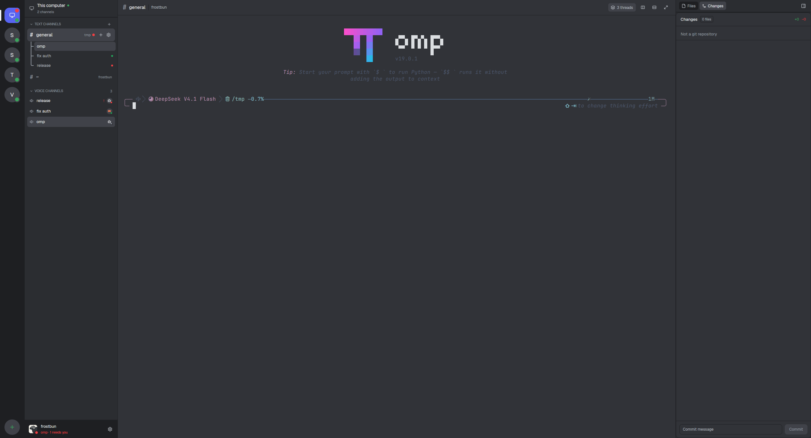

# Herdr Discord

[Herdr](https://herdr.dev) laid out like Discord: a guild rail of machines, the
channel list of one machine's spaces, threads nested under the open channel, and
Files/Changes on the right — in Discord's own colours.



**guild → machine · channel → workspace (space) · thread → pane**

## Install

Copy the folders into your Herdr config:

```sh
cp -r layouts/discord.json layouts/discord.svg themes/discord.json ~/.config/herdr-app/
cp -r mods/discord-* ~/.config/herdr-app/mods/
```

Then pick the `discord` layout in Herdr. `herdr-app check mods/<name>` validates
each mod; `herdr-app commands` lists app commands.

Requires a Herdr build that ships the `files`, `changes` and `machine-add` mods
and the `workspace-chrome`, `pane` and `tabs` icons.

## What's in here

| path | what |
|---|---|
| `layouts/discord.json` | the layout tree |
| `themes/discord.json` | Discord's palette |
| `mods/discord-guilds` | the machine rail |
| `mods/discord-channels` | channel column, user card, pane-area switch |
| `mods/discord-threads` | channel header, thread headers, rename dialog |
| `mods/discord-side` | Files/Changes switcher |
| `mods/discord-menu` | the right-click menus |
| `mods/discord-no-space` | the empty pane area |
| `preview.png` | screenshot of the running layout |

`RECIPE.md` documents every node, prop, shared key and behaviour in detail, plus
the traps found while building it (a missing `setShared` import that silently
keeps the last good build running, the guide line breaking if a row's height
changes, and so on). Read that before changing the structure.

## Notes

- Nothing is created behind your back. A machine with no spaces shows an empty
  channel list and *No space open*; the user creates a space when they want one.
- The pane area follows the machine you are looking at, not whichever space
  Herdr happens to show, so closing a machine's last shell doesn't drag another
  machine's terminal into view.
- Thread names live in `discord.paneNames`, keyed by tab and position, so they
  survive a restart. The machine pin is `discord.guild` (`""` = this computer).

## Licence

MIT.
