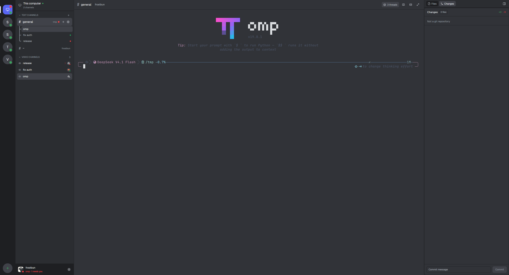

# Discord

Herdr laid out like Discord: a guild rail of machines, the channel list of one machine's spaces, threads nested under the open channel, and Files/Changes on the right. Discord's own colours come with it.

## What you see

Left to right:

1. **Guild rail**, 76 px, `#1e1f22`. One 48 px round tile per machine — this computer first, then machines by name. The selected one is a `#5865f2` rounded square with a white 4×34 px pill on the window edge. Each tile carries two dots: bottom-right connection (green connected, amber loading, grey away), top-right a red dot when any agent there is blocked or finished unseen — no count, the tooltip says how many. Below the tiles, a round `+` opens the machine picker.
2. **Channel column**, 236 px (180–360), `#2b2d31`. A 54 px header: machine icon, its name, a state dot, "N channels". Then `TEXT CHANNELS` with a `+`, then a 40 px row per space: `#` at 18 px, the name at 15 px, the folder's last segment in 11 px grey, a status dot or spinner, and — when open or hovered — `+` (new thread) and a gear (channel menu). The open channel is a `#404249` pill. Under it its threads: a 2 px guide line in the text colour, a stub into each thread, and a filled pill for the focused one. **Voice channels** follows, one row per agent in that space with a speaker icon and status ring; sub-agents sit under their parent, indented. At the bottom a 56 px user card: avatar with a presence dot, your user name, and the focused pane with what wants you. The dot is red when an agent is blocked *or* finished unseen, green when nothing waits; clicking the card opens that agent and pins its machine. A settings gear sits at the right.
3. **Work column**, `#313338`. A 48 px channel header: `#`, the space's name, `·` and its branch or folder, the machine's state if not ready, an "N threads" chip, split-right/down and zoom for the pane in front, `+` for a new thread, and on Linux/Windows minimize/maximize/close. Below it, a **stack**: either the active tab's panes (no frame, no header, 6 px gaps, 4 px radius, terminals edge to edge) or, when the machine you are looking at has no space, **"No space open"** with the machine's name and a `+ New space` button.
4. **Side column**, 280 px (180–1200), `#2b2d31`. A 38 px bar with `Files` and `Changes` tabs over one stack and a button that folds the column away; the channel header then shows the button to bring it back.

Text is Discord's: 13.5 px names, 15 px channel names, 10.5 px uppercase section labels at `#949ba4`.

## How it behaves

- **A guild tile** shows that machine's channels. A machine with **no** channels shows the empty list and the *No space open* pane area — nothing is created.
- **A channel row** switches space; dragging reorders spaces within its machine; right-click opens Rename / New channel / Close.
- **A thread pill** focuses that pane (selecting its tab first); right-click opens Rename thread / Close thread; double-click renames. Empty name goes back to the automatic one.
- **`+` on a channel** starts a thread there (`tab.new`) — it does not create a channel.
- **Voice channel rows** go to the agent's pane; a sub-agent without a pane opens peek.
- **The pane area follows the machine you are looking at**, not the space Herdr happens to show. Closing a machine's last space (or exiting its shell with ctrl+D, which closes pane → tab → space) leaves that machine with none, and the pane area shows **No space open** instead of another machine's terminal. Selecting a machine that has spaces shows its terminals again. The switch happens on a 500 ms timer, because a window in the background does not redraw.
- **Statuses** are the app's: spinner working, red `!` blocked, green dot done, hollow ring idle.

## Built from

Node tree of `layouts/discord.json` — root `row`, `titlebar: none`, `traffic_lights: [12,16]`, `theme: discord`, `terminal_padding: [16,12]`:

| node | type | size | content |
|---|---|---|---|
| `guilds` | block | 76 px | mod `discord-guilds` |
| `channels` | column | 236 px, 180–360 | — |
| ├ `guild-head` | block | 54 px | `discord-channels` props `{guild:true}` |
| ├ `channel-list` | block | — | `discord-channels` |
| └ `person` | block | 56 px, min/max 56 | `discord-channels` props `{person:true}` |
| `work` | column | — | — |
| ├ `channel-head` | block | 48 px, `window_drag` | `discord-threads` props `{channelHead:true}` |
| └ `threads` | stack | — | `active: "pane-area"`; children `pane-area` (`{tab:"active"}`, `pane:{gap:6, radius:4, background:"background", border:{width:0}, focus:{width:0}, lone:false}`) and `no-space` (`mod: discord-no-space`) |
| `side` | column | 280 px, 180–1200 | — |
| ├ `side-head` | block | 38 px | `discord-side` props `{head:true}` |
| └ `side-body` | stack | — | `active: "files"`; children `files`, `changes` (shipped mods) |

Mods — `mods/<name>/main.js` + `mod.json`, every `mod.json` is `{"place":"none"}`:

- **`discord-guilds`** — the rail. `machines()`, `spaces()`; `run("space.select")`, `setShared("discord.guild")`, `openOverlay({mod:"machine-add"})`.
- **`discord-channels`** — channel column, user card, channel menu target, and the pane-area switch. Props `{guild:true}` / `{person:true}` / none. `spaces()`, `machines()`, `panes()`, `agents()`, `terminals()`, `focused()`, `layout()`. `run("space.select"|"space.new"|"space.rename"|"space.move"|"space.close"|"tab.select"|"tab.new"|"pane.focus"|"terminal.peek"|"app.settings"|"layout.select")`, `nextCommand()` for `closeChannel:<space-id>`, `shared("discord.guild")`, `shared("discord.paneNames")`, `home()` for the user name. Switches the `threads` stack on a 500 ms timer.
- **`discord-threads`** — channel header, rename dialog, and the per-pane header. Props `{channelHead:true}` / `{rename:true, pane, tab}` / none. `run("pane.split"|"pane.zoom"|"pane.close"|"tab.rename"|"layout.show"|"window.*")`, `setShared("discord.paneNames")`.
- **`discord-side`** — Files/Changes switcher. `layout()` to read the stack, `run("layout.select")`, `run("layout.hide")`.
- **`discord-menu`** — both right-click menus. Props `{space}` or `{thread, terminal, tab, space}`. `run("space.rename"|"space.new"|"pane.close")` or `run("discord-channels.closeChannel:<id>")`; opens `discord-threads` with `{rename:true}`.
- **`discord-no-space`** — the empty pane area. `spaces()`, `machines()`, `theme()`, `layout()`; `run("space.select"|"space.new"|"layout.select")`, `shared("discord.guild")`. It also re-checks itself on a 400 ms timer while shown, and switches the stack back when the machine gains a space.

Shipped mods used: `files`, `changes`, `machine-add`; icons from `workspace-chrome`, `pane`, `tabs`.

Theme `themes/discord.json`: background `#313338`, foreground `#dbdee1`, ansi 16 Discord colours, `colors` overriding canvas/background `#313338`, surface `#2b2d31`, chrome `#1e1f22`, popover `#111214`, raised/selected `#404249`, hover `#35373c`, border `#1e1f22`, input `#383a40`, muted `#b5bac1`, dim `#949ba4`, accent `#5865f2`, working `#f0b232`, blocked `#f23f43`, done `#23a55a`, idle `#80848e`.

Art: `preview.png` is a real screenshot of the running layout, not a drawing. `layouts/discord.svg` is an older hand-drawn diagram kept for reference only — the screenshot is the source of truth.

## Watch out

- **`setShared` must be imported from `herdr`.** Every mod here that writes shared state does. A build that calls it without the import throws in `init`, Herdr keeps the last good build running, and your edits appear to do nothing — this happened during development and cost several rounds of debugging. `herdr-app check` catches it.
- **No keys.** This layout binds nothing; `keys.json` needs no change. `ctrl-shift-w`/`x` keep their global meanings, so closing a shell or a tab closes it in Herdr itself — which is exactly why the pane area is chosen by machine, not by Herdr's idea of the next space.
- **Pane frame is invisible on purpose** (border width 0); adding a border stops it reading as Discord's flat column.
- **Thread names are per tab and position** in `discord.paneNames`, keyed `${tab}/${index}`, so they survive a restart. A single-pane tab with a Herdr tab name shows that name.
- **The machine pin** (`discord.guild`, `""` = this computer) is set by clicking a guild tile or showing one of its spaces. `spaces()` reports `null` for this computer while the pin is `""`; every comparison normalises both sides.
- **The guide line** overlaps each thread row by 3 px top and bottom. Change a row's height or padding and the line breaks into dashes.
- **The empty state's button is the only way to create a space from it** — by design; nothing is created behind your back.
- The user name is the last segment of `home()` (`/home/ada` → `ada`).

## Done when

- `herdr-app check mods/discord-guilds`, `…/discord-channels`, `…/discord-threads`, `…/discord-side`, `…/discord-menu`, `…/discord-no-space` all report `check passed`.
- `herdr-app status` reports `"errors": []` with the layout shown.
- The window shows a 76 px rail, a 236 px channel column, and Files/Changes on the right; the bottom-left card reads your user name, not "Herdr".
- An open channel lists its panes on one continuous 2 px guide line, the last turning in with nothing below it.
- Clicking a machine that has no spaces shows **No space open** and its `+ New space`, not another machine's terminal.
- Closing the last space of a machine leaves the same message on screen.
